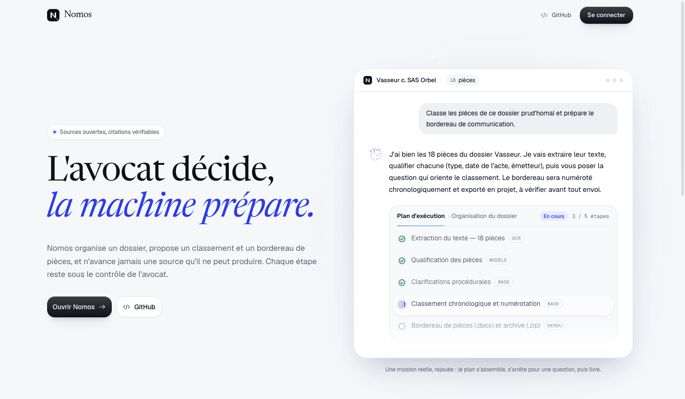

<p align="center">
  <picture>
    <source media="(prefers-color-scheme: dark)" srcset="docs/assets/nomos-mark-dark.svg">
    
  </picture>
</p>

<h1 align="center">Nomos</h1>

<p align="center">
  <b>An open-source agentic assistant for French legal practice.</b><br>
  The machine plans, the lawyer decides.
</p>

<p align="center">
  <a href="#running-it-locally"><b>Run it locally</b></a> ·
  <a href="#before-you-put-a-real-client-file-in-it">Before you use it</a>
</p>

<p align="center">
  <a href="LICENSE"></a>
  
  
  
  
</p>

<p align="center">
  <picture>
    <source media="(prefers-color-scheme: dark)" srcset="docs/assets/landing-dark.png">
    
  </picture>
</p>

Nomos is built for **avocats and juristes d'entreprise** who receive a matter as a pile of
unsorted files — scanned letters, contracts, mail exports, attestations — and have to turn it
into something a court or a client will accept. It looks like a chat and behaves like an agent:
you type an instruction and attach documents, and one durable agent run works in the thread —
reading the pièces, searching the law, asking the questions that change the legal strategy —
and produces verified answers and files.

> **Nomos is a drafting aid with mandatory verification, not an answer engine.** Every output is
> a draft that a lawyer must check before it leaves the firm. Read
> [Before you put a real client file in it](#before-you-put-a-real-client-file-in-it) first.

---

## What it does

### Organise a dossier

1. Create a dossier and upload the pièces (PDFs, scans, DOCX, XLSX) — or drop documents on a
   conversation and type your question: one send files them into the bound dossier, or into a
   new one that Nomos names. Nothing is ever read outside a dossier.
2. Nomos stores each original untouched (hashed, never modified), sniffs its type, extracts the
   text layer and falls back to OCR for scanned pages.
3. Each pièce is qualified against a server-owned schema — type de pièce, date de l'acte,
   émetteur, destinataire, parties, titre, résumé, confidence.
4. The pièces are numbered in the order they are filed and given normalised filenames. Every
   field stays editable.
5. Export produces a **bordereau de communication de pièces** (`.docx`, rendered by pandoc from
   a controlled template) and a **ZIP** of the renamed originals. Unapproved exports are stamped
   « projet — vérification de l'avocat requise ».

Actes (requête, assignation, mise en demeure) are drafted only under a **compétence** — a
versioned playbook picked from the composer's `/` menu and pinned to the turn.

### The agent

Every turn is one durable **ReAct agent** run. The agent decides each step itself — read the
dossier's pièces, search Légifrance and Judilibre, search the web, ask the lawyer, draft and
revise a document, verify it — and iterates on its own work.
A question to the lawyer parks the run; a skipped question is recorded as an answer, never as
silence.

- **Bounded and durable.** At most 40 model dispatches per turn, each reserved in Postgres
  before it is sent. Every decision and tool call is a runner step, so a restart resumes the
  loop and a closed tab only loses the view.
- **Checked before it is shown.** A date, amount or quote attributed to a pièce must appear in
  its text (otherwise it is flagged « À vérifier »). A legal citation must resolve against a
  retrieved source version (otherwise it is refused). A request read as exhaustive needs every
  pièce read, from a coverage ledger the agent cannot write itself.
- **Revalidated against the official source.** At publication every legal citation is
  re-fetched by its exact identity (Légifrance, Judilibre) and must come back with the same text
  and a validity covering the period. When a source is down, nothing is published.
- **Exact places in the pièces.** A PDF is cited by page and paragraph, a DOCX by paragraph, an
  XLSX by sheet and cell.
- **Confidential by construction.** Web searches run in an isolated request with no dossier
  context. Every public query first passes a deny-list built from the dossier (party names,
  emails, phones, addresses, IBAN/SIRET/SIREN/NIR, amounts, dates, any six-word run of pièce
  text); a hit is refused and the agent rephrases.
- **Retry-safe.** Every send carries a client `request_id`; a retry returns the turn already
  accepted instead of starting a second one.

## Status

Nomos is under active development. Verified end to end against a local Postgres:

- auth, invite-only sign-up, two-factor, tenant authorization (the **firm** is the Casbin
  domain), deep health check;
- the dossier: upload → text extraction and OCR → qualification → exported `.docx` bordereau
  and ZIP;
- durability: the event cursor is gap-free, SSE replays from the durable log, a dropped stream
  is loss of observation rather than cancellation, and SIGTERM stops the runner before HTTP
  drains;
- hybrid legal retrieval over the employment-law scope of the Code du travail, measured by a
  relevance harness (see [Evaluation](#evaluation)).

Known gaps:

- **The agent's release gate has not passed.** A full production-model evaluation and a
  lawyer's approval of what it produced are still pending
  ([`api/eval/agent/README.md`](api/eval/agent/README.md)).
- **Judilibre and the AgentPublic-legi bootstrap are not wired into the corpus loader**
  (`POST /api/admin/corpus/sync` answers 501 for both); their connectors exist and are tested
  against the PISTE sandbox.
- The citation gate checks existence, quotation accuracy and temporal applicability.
  Precedential weight and fit to the facts are the lawyer's, and always will be.
- Tenant isolation is application-level (mandatory tenant-scoped repositories plus adversarial
  tests), **not** Postgres row-level security.
- Uploads are not scanned for malware.

## Architecture

```
SvelteKit (adapter-node)       chat shell, agent activity, pièces table, Better Auth at /auth/*
        │  /api/*  (cookie session)  ·  SSE + cursor polling for run events
Go API (Gin, :8000)            controllers → services → tenant-scoped repositories
        │                      durable runner: claimer · pools (ocr/render/llm/db) · reaper
        ├── Postgres + pgvector   dossiers, pièces, runs/steps/events, legal + pièce chunks, llm_calls
        ├── S3 (or a local dir)   <app>/<tenant>/<dossier>/… originals, artifacts, exports
        ├── OpenRouter            agent, extraction, vision OCR, embeddings, rerank
        └── PISTE                 Légifrance + Judilibre (OAuth2 client credentials)
```

- **Durable runner** — a Postgres queue (`SKIP LOCKED`, leases, heartbeats, conditional
  requeue by a reaper) running as goroutines inside the API process. No Redis, no separate
  worker. Execution is at-least-once by design; every step has a stable idempotency key.
- **Ingestion** — MIME sniffing, hashing, `pdftotext -layout`, then `pdftoppm` + local
  `tesseract` (French) for scans. Remote vision OCR is off by default; when an administrator
  enables it, any page the model does not return falls back to tesseract.
- **Hybrid retrieval** — for the public corpus, HNSW over `halfvec` plus a French full-text arm,
  fused by reciprocal rank fusion and reranked. For private dossier chunks, no ANN index: filter
  on tenant + dossier, then exact scoring.
- **DOCX** — one renderer, pandoc, fed a server-owned structured document. Never arbitrary LLM
  markdown, never a shell string.
- **Cost accounting** — every model call is recorded in `llm_calls` before dispatch and
  reconciled with its usage and the provider-reported cost.
- **Deletion is a purge** — deleting a dossier removes its pièces, stored originals, chunks,
  citations, runs and deliverables; *Paramètres › Données* erases everything a user created.
- **Interface** — French-first, chat-first. Its design language, *Encre*, is ink-monochrome
  with one Outremer accent and a cyan *signal* that appears only while the machine works.

| Entity | What it is |
| --- | --- |
| **firm** | The tenant, and the Casbin authorization domain. |
| **dossier** | One matter. Owns its pièces, runs and exports. |
| **pièce** | One document: the immutable original plus the qualification metadata the lawyer corrects. Renaming is metadata applied at export. |
| **run** | One agent turn (or one ingestion) over a dossier, decomposed into leased steps with attempts, events and questions. Survives a restart. |
| **compétence** | An immutable, versioned playbook. Picking one pins its version to the turn. |
| **citation** | A claim frozen against an exact retrieved source version, with its quote, hash, as-of date and verification state — *retrieved → machine-checked → lawyer-verified*. |

## Running it locally

Requirements: Go 1.26, Node 24, Docker (for the local Postgres), and the document tools —
`brew install poppler tesseract tesseract-lang pandoc` on macOS. Local OCR needs the French
Tesseract data (`fra.traineddata`); without it every scan fails.

```bash
./dev.sh          # .env files, deps, a pgvector Postgres in docker, both servers, hot reload
```

`./dev.sh` copies `api/.env.template` and `front/.env.template` on first run and starts (or
reuses) a `pgvector/pgvector:pg17` container named `nomos-postgres` on port **5433**. The
`vector` and `unaccent` extensions are required — a stock Postgres will not do. Then open
http://localhost:5173 and sign in as `admin@example.com` / `NOMOS2026` — the template defaults,
for local use only.

The variables that matter (the full list, with comments, is in the two `.env.template` files):

| Variable | Why |
| --- | --- |
| `DATABASE_URL` | Shared by Better Auth (front) and the API. Empty → 503 everywhere. |
| `BETTER_AUTH_SECRET` | Server-only. `openssl rand -base64 32`. |
| `BOOTSTRAP_ADMIN_EMAIL` / `BOOTSTRAP_ADMIN_PASSWORD` | The first admin, seeded on boot (template defaults `admin@example.com` / `NOMOS2026`); set the same email in both `.env` files, and your own password in production. Sign-up is invite-only after that. |
| `OPENROUTER_API_KEY` | Nomos' inference. Empty → its LLM services return 503. |
| `PLANNER_MODEL`, `DRAFTER_MODEL`, `EXTRACTION_MODEL`, `VISION_MODEL` | Model routing. |
| `EMBEDDING_MODEL` / `EMBEDDING_DIMS` | Default `openai/text-embedding-3-small` / `1536`. The dimension is baked into the column type — see below. |
| `PISTE_CLIENT_ID` / `PISTE_CLIENT_SECRET` | Légifrance + Judilibre: register on [piste.gouv.fr](https://piste.gouv.fr) and accept the CGU for both. Empty disables the connectors. |
| `PISTE_TOKEN_URL`, `LEGIFRANCE_BASE_URL`, `JUDILIBRE_BASE_URL` | Empty → production. The sandbox has its own credentials, so the hosts move with the id/secret pair. |
| `CORPUS_AUTOSEED_SOURCES` | Corpus sources loaded at boot when absent (default `legifrance`). Empty disables. |
| `VISION_OCR_ENABLED` | Remote vision OCR of scans. Off by default, deliberately. |
| `S3_*` | Endpoint, bucket and keys for S3-compatible storage. Any of them empty → local blobs under `api/tmp/blobs` (development only, not durable). |
| `STEP_CONCURRENCY_{OCR,RENDER,LLM,DB}` | Runner pool sizes, per process. |

Every external service is optional: without its key, the corresponding routes return 503
rather than degrading silently.

**Changing `EMBEDDING_DIMS` on an existing database is a manual operation.** The schema is
applied by GORM `AutoMigrate`, which only adds — it will not widen `halfvec(N)`. An existing
database needs the vectors cleared, the HNSW index dropped, the columns retyped and the corpus
re-embedded:

```sql
UPDATE legal_chunks SET embedding = NULL, embedding_model = '';
UPDATE piece_chunks SET embedding = NULL, embedding_model = '';
DROP INDEX IF EXISTS idx_legal_chunks_embedding;
ALTER TABLE legal_chunks ALTER COLUMN embedding TYPE halfvec(1536);
ALTER TABLE piece_chunks ALTER COLUMN embedding TYPE halfvec(1536);
```

The next boot rebuilds the index; re-run the corpus sync to refill the vectors.

## Deploying

Nomos is two containers sharing one Postgres:

- **api** — `api/Dockerfile`, listens on `:8000`, ships poppler, tesseract (French) and pandoc.
- **front** — `front/Dockerfile`, the SvelteKit Node server on `:8080`. It serves the UI and
  Better Auth at `/auth/*`, and applies Better Auth's schema on boot.

Route `/api/*` to the api and everything else (including `/auth/*`) to the front. The API
applies its own schema on boot. The database must have `vector` and `unaccent` enabled at
creation, since the application user usually cannot `CREATE EXTENSION`. Give both containers the
same `DATABASE_URL`, set `BETTER_AUTH_SECRET` and `BETTER_AUTH_URL` on the front, and
`APP_BASE_URL`, `CORS_ORIGINS` and the S3 settings on the api. The API can run several
replicas: claiming, progress and clarification pauses are coordinated through Postgres.

## Evaluation

```bash
# -p 1 is required: every package's tests share one Postgres.
cd api   && go vet ./... && go test -p 1 ./...
cd front && npm run check
cd front && npx playwright install chromium && npm run test:e2e -- --project=chromium
```

The Playwright suite drives the agent thread against a mocked API on its own port, so it never
touches a running API or database.

**Retrieval is measured, not asserted.** `go run ./eval/cmd -strategy all` (from `api/`) scores
the product's own retrieval path over 106 hand-written French queries with graded gold
articles, against a committed fixture corpus of 282 Code du travail articles. Baseline at top-k
10 over 88 graded queries:

| strategy | R@1 | R@10 | MRR | nDCG@10 | p50 | USD/1k q |
| --- | --- | --- | --- | --- | --- | --- |
| vector | 0.364 | 0.894 | 0.882 | 0.819 | 435 ms | 0.0004 |
| fts | 0.090 | 0.499 | 0.367 | 0.380 | 4 ms | 0.000 |
| rrf | 0.297 | 0.821 | 0.785 | 0.740 | 439 ms | 0.0004 |
| **rrf_rerank** | **0.385** | **0.902** | **0.918** | **0.857** | 744 ms | 2.00 |

On this small corpus the dense arm alone beats plain fusion; only the reranker recovers the
loss, which is why `rrf_rerank` ships. The lexical arm earns its place by rescuing queries the
dense arm misses and by being fully accent- and case-invariant. The full reading, including
where retrieval is weak, is in [`api/eval/README.md`](api/eval/README.md).

**The agent's release gate** plays a 72-case French matrix (12 instruction classes × 6 dossier
states) plus 12 agent-failure cases on fictional dossiers with the production models, judges
the outcome with deterministic oracles, and requires a lawyer's approval of every output
([`api/eval/agent/README.md`](api/eval/agent/README.md)). The fictional dossiers under
`testdata/` are not published; the suites that need them fail clearly without them, and
`api/eval/agent/testdata/manifest.json` pins every file by hash.

## Sources

Nomos indexes **open sources only**, under **Licence Ouverte 2.0 with attribution**:
Légifrance (codes, LODA, JORF, KALI, JURI), Judilibre (Cass., CA, TJ, pseudonymised), JADE,
CNIL, CONSTIT, BOFiP, and EUR-Lex under the EU reuse notice. Attribution, update date and
licence version are kept with every indexed version.

Today the loader pulls the employment-law scope of the Code du travail from Légifrance — 695
articles across the 33 article families of the individual employment dispute — on boot or via
`POST /api/admin/corpus/sync {"source":"legifrance"}`. That is deliberately one practice area:
the whole of LEGI is ~10⁷ vectors and 80–150 GB. Widening it means editing
`employmentFamilies` in `api/services/corpus.go`, which is a decision about database size.

**Paywalled doctrine (Navis, Dalloz, LexisNexis, Lamy, Doctrine.fr) has no connector, on
purpose.** Their terms forbid scraping and re-publication, and a firm's licence to read a
document does not grant the right to embed it into a shared corpus. A firm may import documents
into its own tenant, under its own responsibility.

Judilibre disclaims completeness and freshness, and DILA is explicit that the authenticated
Légifrance publication is the opposable text. Anything indexed here is a cache; export-time
revalidation is what makes a citation trustworthy.

## Before you put a real client file in it

These are product requirements, not footer disclaimers. Production use needs French counsel
and a DPO.

- **Secret professionnel.** The RIN puts the lawyer in charge of the whole confidentiality
  chain, and the CNB's guidance — including *Déontologie et intelligence artificielle* (March
  2026) — warns against sending client information to generative AI and requires human control
  over every generated output. An OpenAI-compatible URL is not a compliance boundary: approve
  every inference route contractually and technically (no-training terms, retention and
  deletion, subprocessors, incident notification).
- **« Souverain » / SecNumCloud is NOT claimed.** Inference runs on OpenRouter, which routes to
  several upstream providers. The client is OpenAI-compatible, so a self-hosted vLLM endpoint is
  a configuration change — until you make it, do not make the claim.
- **RGPD.** Dossiers contain special-category data, alleged offences, employee data, minors and
  third parties. Pseudonymisation is not anonymisation. Roles, legal basis, an Article 28 DPA, a
  ROPA, retention schedules, an AIPD and a transfer mechanism all come before launch.
- **Judicial open data.** COJ art. L. 111-13 prohibits reusing judges' and clerks' identity data
  to evaluate, compare or predict their professional practices. Nomos bans judge ranking,
  judge-outcome prediction and any feature meant to reverse pseudonymisation — a test fails the
  build if one appears.
- **Every output requires lawyer verification.** No citation comes from model memory; each is
  bound to an immutable retrieved version and an exact quote. Unapproved exports are stamped as
  drafts. The review screen is the control, and it is yours to use.

## Documentation

- [`api/eval/README.md`](api/eval/README.md) and
  [`api/eval/agent/README.md`](api/eval/agent/README.md) — retrieval and agent evaluation.
- [`api/templates/README.md`](api/templates/README.md) — the controlled document templates.

## License

Nomos is licensed under the [Apache License 2.0](LICENSE).
